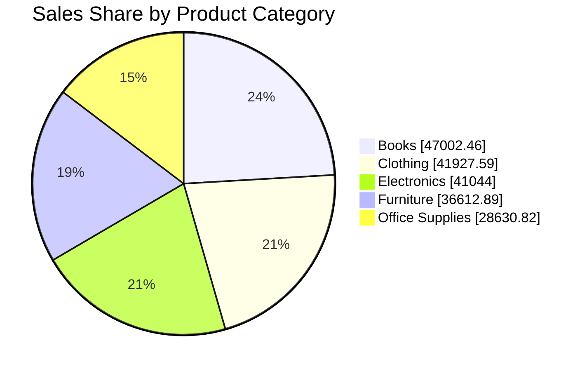

# PR-2-ANALYZERR
<div align="center">


<a href="https://git.io/typing-svg">
  
</a>

<br/>

> ### 💭 *"Numbers tell a story — a good analyst simply learns how to listen."*

<br/>


</div>

<br/>

<div align="center">

**[About](#about) · [Objectives](#objectives) · [KPIs](#kpis) · [Insights](#insights) · [Breakdown](#breakdown) · [Workbook](#workbook) · [Charts](#charts) · [Analysis](#analysis) · [Conclusion](#conclusion) · [Usage](#usage) · [Author](#author)**

</div>

<div align="center">

</div>

<a id="about"></a>
<div align="center">

</div>

This project is a **complete Sales Analytics workbook built in Microsoft Excel**. It takes **200 sales orders** (10 Apr 2024 → 07 Apr 2025) from **30 customers** across **5 regions** and **5 product categories**, and converts them into a clean, interactive dashboard with KPIs, charts, customer ranking, regression, descriptive statistics and a what-if discount simulator.

Everything is **formula-driven**, so when the dataset changes, the KPIs, tables, charts and even the written *Key Insights* update automatically. ⚡

<div align="center">

</div> 


<a id="objectives"></a>
<div align="center">

</div>

- 📊 Track overall **sales performance** with clear KPIs (sales, orders, profit, margin, discount)
- 🌎 Find the **best and weakest regions, product categories and months**
- 👑 Identify **high-value customers** and how much of the business depends on them
- 📈 Understand the **relationship between Sales and Profit** using regression
- 🏷️ Test **how discounts affect total profit** with a what-if simulator
- 🗣️ Present results as **data storytelling**: insights that update automatically

<div align="center">

</div>

<a id="kpis"></a>
<div align="center">

</div>

<div align="center">

  <br/><br/>
  <br/><br/>
  <br/><br/>
  <br/><br/>

</div>

<div align="center">

</div>

<a id="insights"></a>
<div align="center">

</div>

1. 🌎 **West** is the top region with **44,084** in sales (22.6 % of total); **East** is the weakest.
2. 📚 **Books** leads the product categories (24.1 % of sales); **Office Supplies** contributes the least.
3. 📅 Best month was **Sep 2024** (20,534); the lowest was **Apr 2025** (3,212), which is only a partial month (data ends 07 Apr).
4. 👑 The **Top 10 customers generate 47.4 %** of all purchases; **CUST015** is #1.
5. 📈 **Regression:** every extra 1 of Sales adds about **0.35 profit** (R² = 0.60).
6. 🏷️ **What-if:** a flat 10 % discount would change total profit by only **−249 (−0.4 %)** versus today.

<div align="center">

</div>

<a id="breakdown"></a>
<div align="center">

</div>

### 🌎 Sales by Region

| Region | Total Sales | Share | Performance |
|:--|--:|--:|:--|
| 🥇 West | 44,083.58 | 22.6 % | ████████████ |
| 🥈 Central | 43,468.33 | 22.3 % | ████████████ |
| 🥉 South | 40,248.79 | 20.6 % | ███████████░ |
| North | 34,975.42 | 17.9 % | ██████████░░ |
| East | 32,441.64 | 16.6 % | █████████░░░ |

### 🛍️ Sales by Product Category

| Category | Total Sales | Share | Performance |
|:--|--:|--:|:--|
| 🥇 Books | 47,002.46 | 24.1 % | ████████████ |
| 🥈 Clothing | 41,927.59 | 21.5 % | ███████████░ |
| 🥉 Electronics | 41,044.00 | 21.0 % | ██████████░░ |
| Furniture | 36,612.89 | 18.8 % | █████████░░░ |
| Office Supplies | 28,630.82 | 14.7 % | ███████░░░░░ |

### 📅 Monthly Sales Trend

| Month | Sales | MoM Growth | Orders | Profit |
|:--|--:|:-:|--:|--:|
| Apr 2024 | 19,029.96 | – | 19 | 6,244.01 |
| May 2024 | 18,507.34 | 🔻 −2.7 % | 21 | 6,121.35 |
| Jun 2024 | 20,187.51 | 🔺 +9.1 % | 20 | 6,918.00 |
| Jul 2024 | 11,609.04 | 🔻 −42.5 % | 12 | 3,743.85 |
| Aug 2024 | 10,091.70 | 🔻 −13.1 % | 10 | 3,302.84 |
| Sep 2024 | 20,533.50 | 🔺 +103.5 % | 20 | 7,457.52 |
| Oct 2024 | 14,215.24 | 🔻 −30.8 % | 14 | 4,861.70 |
| Nov 2024 | 20,135.03 | 🔺 +41.6 % | 20 | 6,814.88 |
| Dec 2024 | 11,120.04 | 🔻 −44.8 % | 11 | 3,549.99 |
| Jan 2025 | 14,914.65 | 🔺 +34.1 % | 16 | 5,763.40 |
| Feb 2025 | 14,006.36 | 🔻 −6.1 % | 14 | 5,039.23 |
| Mar 2025 | 17,655.22 | 🔺 +26.1 % | 19 | 7,071.39 |
| Apr 2025* | 3,212.17 | 🔻 −81.8 % | 4 | 1,398.85 |

<sub>*Partial month: data ends on 07 Apr 2025.</sub>

### 👑 Top 10 Customers (High Value)

| Rank | Customer | Total Purchase | % of All Purchases |
|:-:|:-:|--:|--:|
| 1 | CUST015 | 10,166.61 | 5.78 % |
| 2 | CUST007 | 9,535.86 | 5.42 % |
| 3 | CUST028 | 9,150.27 | 5.20 % |
| 4 | CUST008 | 8,762.74 | 4.98 % |
| 5 | CUST026 | 8,599.26 | 4.89 % |
| 6 | CUST021 | 7,757.51 | 4.41 % |
| 7 | CUST012 | 7,588.56 | 4.31 % |
| 8 | CUST003 | 7,482.19 | 4.25 % |
| 9 | CUST030 | 7,206.61 | 4.10 % |
| 10 | CUST004 | 7,105.25 | 4.04 % |
| | **Top 10 total** | **83,354.85** | **47.38 %** |

> ℹ️ *Total Purchase = Sales after discount. The Top N cut-off for the "High Value" tier is editable on the CUSTOMERS sheet (default = 10).*

<div align="center">

</div>

<a id="workbook"></a>
<div align="center">

</div>

| # | Sheet | What it contains |
|:-:|:--|:--|
| 1 | **DASHBOARD** | KPI cards, 3 charts and auto-updating Key Insights |
| 2 | **ANALYSIS** | Cleaned dataset (200 rows) with calculated columns |
| 3 | **CUSTOMERS** | Customer summary, rank, High-Value tiers and Top 10 leaderboard |
| 4 | **PIVOT TABLE** | Region / Category / Month summaries built with `SUMIFS` |
| 5 | **WHAT IF** | Discount scenario simulator and sensitivity table |
| 6 | **REGRESSION** | Linear regression (Profit vs Sales) with prediction tool |
| 7 | **DESCRIPTIVE STATS** | Mean, median, std. deviation, skewness, kurtosis and Sales histogram |

<div align="center">

</div>

<a id="dataset"></a>
<div align="center">

</div>

**Raw columns:** `Customer_ID` · `Customer_Name` · `Region` · `Product_Category` · `Sales` · `Quantity` · `Discount` · `Order_Date` · `Profit`

**Calculated columns:** `Discount Amount` · `Total Purchase` (sales after discount) · `Profit Margin` · `Profit Status` · `Order Month` · `Timestamp`

<div align="center">

</div>

<a id="charts"></a>
<div align="center">

</div>

| Chart | Type | Sheet |
|:--|:-:|:--|
| Sales by Region | 📊 Bar | Dashboard |
| Sales Share by Product Category | 🥧 Pie | Dashboard |
| Monthly Sales Trend | 📉 Line | Dashboard |
| Total Profit vs Discount Rate | 📉 Line | What If |
| Profit vs Sales (with trendline) | 🔵 Scatter | Regression |
| Sales Distribution | 📊 Histogram | Descriptive Stats |



<div align="center">

</div>

<a id="analysis"></a>
<div align="center">

</div>

### 📐 Linear Regression (Profit vs Sales)

| Metric | Result |
|:--|:--|
| Equation | `Profit = -1.03 + 0.3509 × Sales` |
| Multiple R | 0.7734 |
| R² | 0.5982 (Sales explains ~59.8 % of Profit) |
| Significance F | 4.63 × 10⁻⁴¹ (statistically significant) |

### 🏷️ What-If: Discount vs Profit

| Discount Rate | Total Profit | Change vs Current |
|:-:|--:|--:|
| 0 % | 87,559.77 | +28.2 % |
| 5 % | 77,798.88 | +13.9 % |
| **10 %** | **68,037.99** | **−0.4 %** |
| 15 % | 58,277.10 | −14.7 % |
| 20 % | 48,516.22 | −29.0 % |
| 25 % | 38,755.33 | −43.2 % |
| 30 % | 28,994.44 | −57.5 % |

> 👉 Lower discounts protect profit, but the current ~9.9 % average discount is close to the 10 % scenario.

### 📏 Descriptive Statistics

| Statistic | Sales | Quantity | Profit |
|:--|--:|--:|--:|
| Mean | 976.09 | 10.00 | 341.44 |
| Median | 976.72 | 10 | 332.26 |
| Std. Deviation | 299.27 | 5.65 | 135.77 |
| Minimum | 258.51 | 1 | 64.63 |
| Maximum | 1,923.66 | 19 | 769.46 |
| Skewness | 0.15 | 0.06 | 0.57 |

> 📦 Most orders fall between **750 and 1,250** in sales (118 of 200 orders, 59 %), and the Sales distribution is close to normal.

<div align="center">

</div>

<a id="conclusion"></a>
<div align="center">

</div>

The business earns a healthy **34.98 % profit margin**, with sales fairly well spread across regions and categories. Based on the analysis, these are suggested next steps:

1. 🌎 **Learn from West and Central**, which together bring about 45 % of sales, and **investigate East**. Its weakest spots are Clothing (2,401) and Electronics (2,870) there.
2. 📚 **Keep pushing Books**, and promote or bundle **Office Supplies**, the weakest category (14.7 %). South is especially low on it (2,295).
3. 👑 **Protect top customers** with loyalty offers, since 10 of 30 customers give 47.4 % of purchases.
4. 🏷️ **Review discounting.** In the simulation each 5-point drop in discount adds roughly 9,700 to profit, if order volume stays the same.
5. 📅 **Plan campaigns around the slow months** (Jul, Aug and Dec) and prepare stock for the strong ones (Jun, Sep and Nov).

<div align="center">

</div>

<a id="limitations"></a>
<div align="center">

</div>

- 📆 **Apr 2025 is a partial month** (4 orders, data ends 07 Apr), so its drop is not a real decline.
- 📉 **R² = 0.60**: Sales explains about 60 % of Profit; the other 40 % depends on other factors (category, discount, costs).
- 🏷️ **What-if assumes quantity and costs stay the same**; it does not model customers buying more or less when the discount changes.
- 🗓️ **Only one year of data**, so seasonal patterns are indications, not confirmed trends.
- 💱 The workbook does not mention a currency, so values are shown without a currency symbol.

<div align="center">

</div>

<a id="skills"></a>
<div align="center">

</div>

- ✅ **Formulas:** `SUMIFS`, `COUNTIFS`, `SUMPRODUCT`, `INDEX` + `MATCH`, `LARGE`, `RANK`, `IF` / `IFERROR`
- ✅ **Statistical functions:** `LINEST`, `SLOPE`, `INTERCEPT`, `RSQ`, `CORREL`, `STDEV`, `SKEW`, `KURT`
- ✅ **Excel Tables** with filter arrows for quick slicing
- ✅ **Conditional Formatting** (Top 10 customers highlighted, profit status colours)
- ✅ **Charts:** bar, pie, line, scatter with trendline, histogram
- ✅ **Pivot-style summaries** that refresh automatically
- ✅ **Regression & Descriptive Statistics** (ToolPak-style output using live formulas)
- ✅ **What-If Analysis** with editable input cells
- ✅ **Data storytelling:** insights that rewrite themselves when the data changes

<div align="center">

</div>

<a id="usage"></a>
<div align="center">

</div>

1. **Download** `PR2_FINALL_DASHBOARDSS.xlsx` from this repository.
2. **Open** it in Microsoft Excel (2016 or newer recommended).
3. Start on the **DASHBOARD** sheet to see KPIs, charts and insights.
4. Use the **filter arrows** on the CUSTOMERS sheet to filter by *Customer Tier*.
5. Edit the **yellow cells** (Top N cut-off, scenario discount, bin width, prediction input) to explore your own scenarios.

<div align="center">

</div>

<a id="structure"></a>
<div align="center">

</div>

```text
📦 Sales-Dashboard
 ┣ 📊 PR2_FINALL_DASHBOARDSS.xlsx   → full workbook (7 sheets, 6 charts)
 ┗ 📄 README.md                     → project documentation
```

<div align="center">

</div>

<a id="future"></a>
<div align="center">

</div>

- [ ] Add slicers for Region, Category and Date
- [ ] Add Profit by Category and Customer Tier charts
- [ ] Forecast next months' sales with a trend / moving average
- [ ] Connect the data to Power BI for a live web dashboard

<div align="center">

</div>

<a id="author"></a>
<div align="center">

</div>

<div align="center">

### ✨ **Kavita Khushalani** ✨


*Aspiring Data Analyst — turning data into decisions.*

If you liked this project, please give it a ⭐ — it motivates me to build more!

<br/>

> ### 💭 *"Data gives you the answers — curiosity makes you ask the right questions."*


</div>
